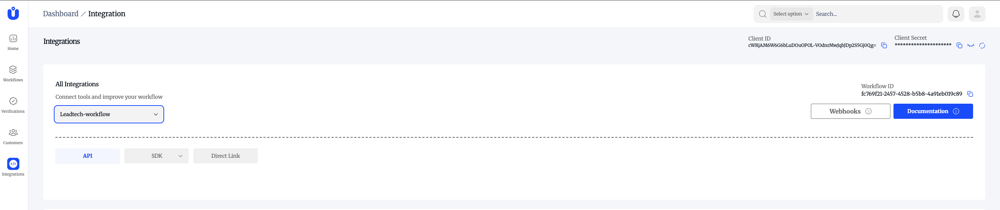
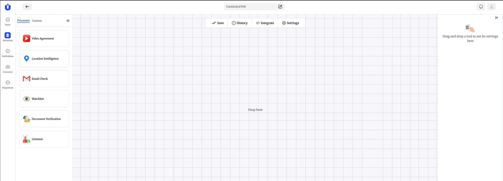
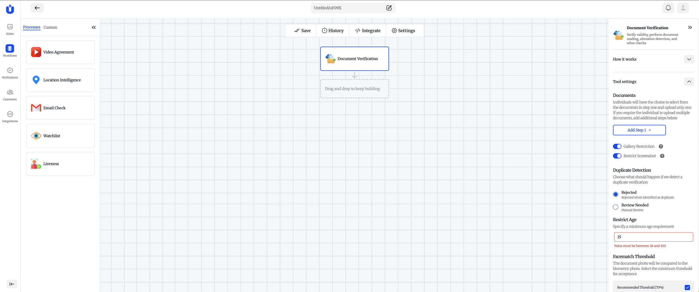

## Prerequisites

Before you begin, you'll need:

1. **Urtentic Account**: Sign up at [urtentic.com](https://app.urtentic.com)
2. **API Credentials**: Obtain your Client ID and API Secret from the integrations page in your dashboard
3. **Workflow ID**: Create a verification workflow in your dashboard

### Generate Your API Credentials

<Frame>
  
</Frame>

Navigate to the integrations page in your dashboard to obtain your API credentials:
- **Client ID**: Your application identifier (sent via `X-CLIENT-ID` header)
- **Client Secret**: Your authentication token (sent via `Authorization: Bearer` header)

### Create a Workflow

<Frame>
  
</Frame>

Set up your verification workflow by defining the required verification processes.

<Frame>
  
</Frame>

Configure your workflow settings including document types, verification steps, and security options.

## Quick Start (5 minutes)

### Step 1: Set Up Your Environment

First, set your API credentials as environment variables:

```bash
export URTENTIC_API_KEY="your-base64-encoded-api-key"
export URTENTIC_CLIENT_ID="your-base64-encoded-client-id"
```

### Step 2: Create Your First Verification

```bash
curl -X POST https://api.urtentic.com/api/v1/verifications \
  -H "Authorization: Bearer $URTENTIC_API_KEY" \
  -H "X-CLIENT-ID: $URTENTIC_CLIENT_ID" \
  -H "Content-Type: application/json" \
  -d '{
    "flowId": "db50ed08-18fa-41e8-9e46-a44aca39f69d",
    "metadata": {
      "userId": "user_12345",
      "applicationId": "app_67890"
    }
  }'
```

**Response:**
```json
{
  "id": "85c94e71-6e3f-4a19-b15c-781d8a876542",
  "flowId": "db50ed08-18fa-41e8-9e46-a44aca39f69d",
  "status": "pending",
  "metadata": {
    "userId": "user_12345",
    "applicationId": "app_67890"
  },
  "createdAt": "2023-12-01T10:00:00Z",
  "verificationUrl": "https://verify.urtentic.com?flowId=db50ed08-18fa-41e8-9e46-a44aca39f69d&clientId=YOUR_CLIENT_ID&metadata=%7B%22userId%22%3A%22user_12345%22%7D"
}
```

### Step 3: Check Verification Status

```bash
curl -X GET https://api.urtentic.com/api/v1/verifications/85c94e71-6e3f-4a19-b15c-781d8a876542 \
  -H "Authorization: Bearer $URTENTIC_API_KEY" \
  -H "X-CLIENT-ID: $URTENTIC_CLIENT_ID"
```

## Integration Examples

<CodeGroup>

```javascript Node.js
const URTENTIC_API_KEY = process.env.URTENTIC_API_KEY;
const URTENTIC_CLIENT_ID = process.env.URTENTIC_CLIENT_ID;
const BASE_URL = 'https://api.urtentic.com/api/v1';

// Create a verification
async function createVerification(flowId, metadata = {}) {
  const response = await fetch(`${BASE_URL}/verifications`, {
    method: 'POST',
    headers: {
      'Authorization': `Bearer ${URTENTIC_API_KEY}`,
      'X-CLIENT-ID': URTENTIC_CLIENT_ID,
      'Content-Type': 'application/json'
    },
    body: JSON.stringify({ flowId, metadata })
  });
  return await response.json();
}

// Check verification status
async function getVerificationStatus(verificationId) {
  const response = await fetch(`${BASE_URL}/verifications/${verificationId}`, {
    headers: {
      'Authorization': `Bearer ${URTENTIC_API_KEY}`,
      'X-CLIENT-ID': URTENTIC_CLIENT_ID
    }
  });
  return await response.json();
}

// Usage
const verification = await createVerification('db50ed08-18fa-41e8-9e46-a44aca39f69d', { userId: 'user_12345' });
console.log('Verification URL:', verification.verificationUrl);
```

```python Python
import requests
import os

URTENTIC_API_KEY = os.getenv('URTENTIC_API_KEY')
URTENTIC_CLIENT_ID = os.getenv('URTENTIC_CLIENT_ID')
BASE_URL = 'https://api.urtentic.com/api/v1'

def create_verification(flow_id, metadata=None):
    if metadata is None:
        metadata = {}
    response = requests.post(
        f'{BASE_URL}/verifications',
        headers={
            'Authorization': f'Bearer {URTENTIC_API_KEY}',
            'X-CLIENT-ID': URTENTIC_CLIENT_ID,
            'Content-Type': 'application/json'
        },
        json={ 'flowId': flow_id, 'metadata': metadata }
    )
    return response.json()

def get_verification_status(verification_id):
    response = requests.get(
        f'{BASE_URL}/verifications/{verification_id}',
        headers={
            'Authorization': f'Bearer {URTENTIC_API_KEY}',
            'X-CLIENT-ID': URTENTIC_CLIENT_ID
        }
    )
    return response.json()

# Usage
verification = create_verification('db50ed08-18fa-41e8-9e46-a44aca39f69d', { 'userId': 'user_12345' })
print(f"Verification URL: {verification['verificationUrl']}")
```

```php PHP
<?php
$apiKey = getenv('URTENTIC_API_KEY');
$clientId = getenv('URTENTIC_CLIENT_ID');
$baseUrl = 'https://api.urtentic.com/api/v1';

function createVerification($flowId, $metadata = []) {
    global $apiKey, $clientId, $baseUrl;
    $data = [ 'flowId' => $flowId, 'metadata' => $metadata ];
    $context = stream_context_create([
        'http' => [
            'method' => 'POST',
            'header' => [
                "Authorization: Bearer $apiKey",
                "X-CLIENT-ID: $clientId",
                'Content-Type: application/json'
            ],
            'content' => json_encode($data)
        ]
    ]);
    $response = file_get_contents("$baseUrl/verifications", false, $context);
    return json_decode($response, true);
}

$verification = createVerification('db50ed08-18fa-41e8-9e46-a44aca39f69d', [ 'userId' => 'user_12345' ]);
echo "Verification URL: " . $verification['verificationUrl'] . PHP_EOL;
?>
```

```java Java
import com.fasterxml.jackson.databind.ObjectMapper;
import java.net.URI;
import java.net.http.HttpClient;
import java.net.http.HttpRequest;
import java.net.http.HttpResponse;
import java.util.Map;

public class UrtenticClient {
    private static final String API_KEY = System.getenv("URTENTIC_API_KEY");
    private static final String CLIENT_ID = System.getenv("URTENTIC_CLIENT_ID");
    private static final String BASE_URL = "https://api.urtentic.com/api/v1";

    private final HttpClient httpClient = HttpClient.newHttpClient();
    private final ObjectMapper mapper = new ObjectMapper();

    // Create a verification
    public Map<?, ?> createVerification(String flowId, Map<String, Object> metadata) throws Exception {
        Map<String, Object> body = Map.of("flowId", flowId, "metadata", metadata);
        String json = mapper.writeValueAsString(body);

        HttpRequest request = HttpRequest.newBuilder()
            .uri(URI.create(BASE_URL + "/verifications"))
            .header("Authorization", "Bearer " + API_KEY)
            .header("X-CLIENT-ID", CLIENT_ID)
            .header("Content-Type", "application/json")
            .POST(HttpRequest.BodyPublishers.ofString(json))
            .build();

        HttpResponse<String> response = httpClient.send(request, HttpResponse.BodyHandlers.ofString());
        return mapper.readValue(response.body(), Map.class);
    }

    // Check verification status
    public Map<?, ?> getVerificationStatus(String verificationId) throws Exception {
        HttpRequest request = HttpRequest.newBuilder()
            .uri(URI.create(BASE_URL + "/verifications/" + verificationId))
            .header("Authorization", "Bearer " + API_KEY)
            .header("X-CLIENT-ID", CLIENT_ID)
            .GET()
            .build();

        HttpResponse<String> response = httpClient.send(request, HttpResponse.BodyHandlers.ofString());
        return mapper.readValue(response.body(), Map.class);
    }

    // Usage
    public static void main(String[] args) throws Exception {
        UrtenticClient client = new UrtenticClient();
        Map<String, Object> metadata = Map.of("userId", "user_12345");
        Map<?, ?> verification = client.createVerification("db50ed08-18fa-41e8-9e46-a44aca39f69d", metadata);
        System.out.println("Verification URL: " + verification.get("verificationUrl"));
    }
}
```

```bash cURL
# Set your API credentials
export URTENTIC_API_KEY="your-base64-encoded-api-key"
export URTENTIC_CLIENT_ID="your-base64-encoded-client-id"

# Create a verification
curl -X POST https://api.urtentic.com/api/v1/verifications \
  -H "Authorization: Bearer $URTENTIC_API_KEY" \
  -H "X-CLIENT-ID: $URTENTIC_CLIENT_ID" \
  -H "Content-Type: application/json" \
  -d '{
    "flowId": "db50ed08-18fa-41e8-9e46-a44aca39f69d",
    "metadata": {
      "userId": "user_12345",
      "applicationId": "app_67890"
    }
  }'

# Check verification status
curl -X GET https://api.urtentic.com/api/v1/verifications/85c94e71-6e3f-4a19-b15c-781d8a876542 \
  -H "Authorization: Bearer $URTENTIC_API_KEY" \
  -H "X-CLIENT-ID: $URTENTIC_CLIENT_ID"
```

</CodeGroup>

## Workflow Types

Each workflow is configured in your Urtentic dashboard — the steps it includes (document verification, liveness, email, etc.) are defined there, not in the API request. The `flowId` identifies which workflow to run, and `metadata` carries your own tracking data.

### Document Verification Only
```json
{
  "flowId": "db50ed08-18fa-41e8-9e46-a44aca39f69d",
  "metadata": {
    "userId": "user_12345"
  }
}
```

### Liveness + Document Verification
```json
{
  "flowId": "c3a2b1d0-5e4f-4a19-b15c-781d8a876542",
  "metadata": {
    "userId": "user_12345"
  }
}
```

### Location + Email Verification
```json
{
  "flowId": "f7e6d5c4-3b2a-4a19-b15c-781d8a876542",
  "metadata": {
    "userId": "user_12345"
  }
}
```

## Handling Webhooks

Set a webhook URL in the dashboard under **Integrations** > **Webhooks** to receive events as verifications progress. Every request is signed: verify the `x-urtentic-signature` header against the raw request body before trusting it.

<CardGroup cols={2}>
  <Card title="Webhook events" icon="bell" href="/webhooks/overview">
    Events, payloads and how delivery works.
  </Card>
  <Card title="Configure and verify" icon="shield-check" href="/webhooks/configuration">
    Set the URL and secret, and verify signatures in Node.js, Python, PHP or Java.
  </Card>
</CardGroup>

## Error Handling

The API uses standard HTTP status codes and returns detailed error messages:

<CodeGroup>

```javascript Node.js
async function handleApiCall() {
  try {
    const response = await fetch(`${BASE_URL}/verifications`, {
      method: 'POST',
      headers: {
        'Authorization': `Bearer ${URTENTIC_API_KEY}`,
        'X-CLIENT-ID': URTENTIC_CLIENT_ID,
        'Content-Type': 'application/json'
      },
      body: JSON.stringify({ flowId: 'db50ed08-18fa-41e8-9e46-a44aca39f69d' })
    });

    if (!response.ok) {
      const error = await response.json();
      console.error('API Error:', error);
      switch (response.status) {
        case 400: console.log('Bad request - check your payload'); break;
        case 401: console.log('Unauthorized - check your API credentials'); break;
        case 429: console.log('Rate limited - wait before retrying'); break;
      }
      return null;
    }
    return await response.json();
  } catch (error) {
    console.error('Network error:', error);
    return null;
  }
}
```

```python Python
import requests
from requests.exceptions import RequestException

def handle_api_call():
    try:
        response = requests.post(
            f'{BASE_URL}/verifications',
            headers={
                'Authorization': f'Bearer {URTENTIC_API_KEY}',
                'X-CLIENT-ID': URTENTIC_CLIENT_ID,
                'Content-Type': 'application/json'
            },
            json={'flowId': 'db50ed08-18fa-41e8-9e46-a44aca39f69d'}
        )
        if not response.ok:
            error_data = response.json()
            print(f'API Error: {error_data}')
            return None
        return response.json()
    except RequestException as e:
        print(f'Network error: {e}')
        return None
```

```php PHP
<?php
function handleApiCall() {
    global $apiKey, $clientId, $baseUrl;
    $data = ['flowId' => 'db50ed08-18fa-41e8-9e46-a44aca39f69d'];
    $context = stream_context_create([
        'http' => [
            'method' => 'POST',
            'header' => [
                "Authorization: Bearer $apiKey",
                "X-CLIENT-ID: $clientId",
                'Content-Type: application/json'
            ],
            'content' => json_encode($data),
            'ignore_errors' => true
        ]
    ]);
    $response = file_get_contents("$baseUrl/verifications", false, $context);
    if ($response === false) {
        error_log('Network error occurred');
        return null;
    }
    return json_decode($response, true);
}
?>
```

```java Java
import com.fasterxml.jackson.databind.ObjectMapper;
import java.net.URI;
import java.net.http.HttpClient;
import java.net.http.HttpRequest;
import java.net.http.HttpResponse;
import java.util.Map;

public Map<?, ?> handleApiCall() {
    try {
        String json = mapper.writeValueAsString(
            Map.of("flowId", "db50ed08-18fa-41e8-9e46-a44aca39f69d")
        );

        HttpRequest request = HttpRequest.newBuilder()
            .uri(URI.create(BASE_URL + "/verifications"))
            .header("Authorization", "Bearer " + API_KEY)
            .header("X-CLIENT-ID", CLIENT_ID)
            .header("Content-Type", "application/json")
            .POST(HttpRequest.BodyPublishers.ofString(json))
            .build();

        HttpResponse<String> response = httpClient.send(request, HttpResponse.BodyHandlers.ofString());

        if (response.statusCode() >= 400) {
            System.err.println("API Error " + response.statusCode() + ": " + response.body());
            switch (response.statusCode()) {
                case 400 -> System.err.println("Bad request - check your payload");
                case 401 -> System.err.println("Unauthorized - check your API credentials");
                case 429 -> System.err.println("Rate limited - wait before retrying");
            }
            return null;
        }

        return mapper.readValue(response.body(), Map.class);
    } catch (Exception e) {
        System.err.println("Network error: " + e.getMessage());
        return null;
    }
}
```

</CodeGroup>

## Next Steps

- [API Reference](/api-reference/introduction) - Complete API documentation
- [SDK Integration](/sdk/introduction) - Client-side SDKs
- [Webhook Setup](/webhooks/overview) - Real-time notifications

## Support

Need help? We're here to assist:

- **Email**: [support@urtentic.com](mailto:support@urtentic.com)
- **Documentation**: [docs.urtentic.com](https://docs.urtentic.com)
- **Status Page**: [status.urtentic.com](https://status.urtentic.com)
